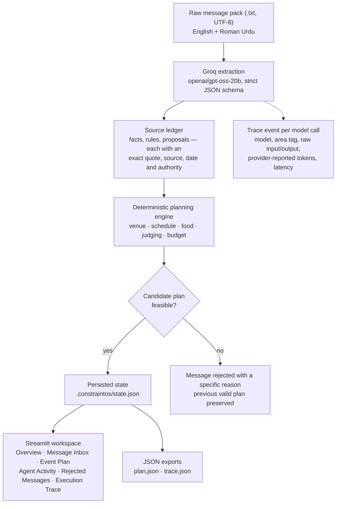

# ConstraintOS

**Source-grounded event planning. Deterministic validation. Auditable AI decisions.**

ConstraintOS turns the way events are actually organised — a stream of emails, WhatsApp messages and notices in English and Roman Urdu — into a validated event plan covering **venue, schedule, food, judging and budget**. An AI model reads the messages; it does not decide the plan. Every figure in the plan is computed and checked by deterministic Python code against the constraints the messages actually contain, and every accepted or rejected message is traceable to an exact quote from its source.

---

## The problem

Operational messages are a hostile input format:

- Prices go stale, and a later correction quietly supersedes an earlier quote.
- Two sources give conflicting instructions, and only one of them has the authority to decide.
- Some messages are proposals awaiting approval, not decisions.
- Some are simply wrong — too few meals to cover the headcount, a venue that cannot hold the audience, a change that breaks the budget cap.
- New constraints appear that nobody anticipated when the event was first described.

A general-purpose chatbot asked to "make a plan" will produce a plausible document that may violate any of these — with no record of which message each number came from, and no way to audit the decision afterwards. ConstraintOS is built around the opposite principle: **extraction is probabilistic, planning is not.**

## How it works



The same command processes the first message pack and every later update. There is no separate "import" and "update" mode.

## Core capabilities

| Capability | What it means in practice |
|---|---|
| Source-grounded extraction | Each fact needs a supporting excerpt from the original message. Python verifies the evidence before accepting the fact into the ledger. |
| English and Roman Urdu | The extraction layer is instructed and schema-constrained for both languages; original text is preserved verbatim in the ledger. |
| Five-area planning | Venue selection, schedule construction, meal quantities, judging assignments and budget totals are computed together, so a change in one area is checked against the other four. |
| Deterministic validation | Capacity, budget-cap, schedule-fit and quantity checks are ordinary Python arithmetic — reproducible, testable, and identical on every run. |
| Authority and corrections | Facts carry a source and an authority level for that source's remit (organiser, finance, vendor, coordinator). Corrections replace the fact they target; outdated or unauthorised claims do not silently overwrite current values. Proposals stay proposals until an authorised source approves them. |
| Incremental updates | State and source facts persist between runs. Python merges new messages, records the affected areas, then builds and validates a candidate across all five areas using the updated ledger. Re-sending an identical file costs zero model calls. |
| Auditable rejection | A message that would make the plan infeasible is rejected with the specific failed check, recorded in the rejection ledger, and the last valid plan remains in force. |
| Token accountability | Token totals are summed only from usage figures the provider actually reported. Calls without reported usage are counted separately — never estimated, never filled in. |

## Architecture decisions

| Component | Technology | Why it was chosen |
|---|---|---|
| Language | Python 3.11+ | The planning engine is arithmetic and data modelling; Python keeps that code short, readable and directly testable. |
| Extraction model | Groq — `openai/gpt-oss-20b` (free tier) | Fast structured-output inference with a strict JSON schema, and per-call token usage reported by the provider. The model only reads; it never calculates the plan. |
| Schemas | Pydantic | The model's output is validated against a strict schema before any of it is trusted. Malformed output is a failed run, not a partial plan. |
| Planning engine | Deterministic Python (`constraintos/planner.py`) | Budget arithmetic, capacity checks and schedule fitting must be exact and reproducible. An LLM asked to do this arithmetic can be confidently wrong; a Python function cannot be wrong in a new way each run. |
| Persistence | Local JSON in `.constraintos/` | State, plan and trace are inspectable and portable. Each file is replaced atomically, and a file lock serialises runs. The runtime directory is git-ignored. |
| Interface | Streamlit | A local interface a judge can launch with one command, showing the same state files the CLI writes — no separate backend to deploy or drift out of sync. |
| Source control | GitHub | The repository is the submission: public, with the full commit history of how the system was built. |

What each layer protects against, if it were removed:

- **Without grounded extraction**, invented or misquoted figures enter the ledger silently.
- **Without the deterministic validator**, the plan is whatever the model found plausible — including over-budget and over-capacity plans.
- **Without persistence**, every update would require re-reading the entire history, and corrections could not be told apart from first mentions.
- **Without the trace**, there is no way to prove which model calls happened, what they cost, or what they returned.

## Getting started (Windows / PowerShell)

You need Python 3.11 or later and a free Groq account for an API key.

```powershell
git clone https://github.com/muhammadhamad-dev/mtm2-event-planner-agent.git
cd mtm2-event-planner-agent

py -m venv .venv
.venv\Scripts\Activate.ps1
python -m pip install -e .
```

Configure the API key for the current PowerShell session (or set a user-level environment variable named `GROQ_API_KEY` in the Windows Environment Variables dialog). **Never put the key in the repository, in a message file, or in a commit.**

```powershell
$env:GROQ_API_KEY = "<your Groq API key>"
```

Verify the provider connection — this makes one small, real model call and prints its trace event:

```powershell
python -m constraintos --check-provider
```

Process an initial message pack, then any later update with the same command pattern. Run from the project directory, and keep message files as UTF-8 text with the original English / Roman Urdu wording intact:

```powershell
python -m constraintos messages.txt
python -m constraintos next-message.txt
```

Launch the dashboard:

```powershell
python -m streamlit run app.py
```

### Dashboard walkthrough

Open [the local dashboard](http://127.0.0.1:8501) and use the left sidebar to switch views.

| View | What it shows |
|---|---|
| **Overview** | Current plan validity, the five planning decisions, budget utilisation, message and rejection counts, and recent outcomes. |
| **Message Inbox** | Original message text, sender and source date where available, extracted facts, and the engine outcome where it can be linked to that message. Model classifications are shown separately. |
| **Event Plan** | Venue, Schedule, Food, Judging and Budget subviews with the selected decisions, source evidence, and available alternatives. |
| **Agent Activity** | Chronological processing history with separate entries for Groq calls and Python operations, including dependency analysis, validation, and rejections. |
| **Rejected Messages** | Original rejected text and the recorded validation reason, with prior-plan retention shown when the trace supports it. |
| **Execution Trace** | Numbered Groq calls with the model, area tag, status, latency, provider-reported tokens, and expandable raw requests and responses. |

Use **Upload TXT**, then **Process messages**, for both the initial pack and subsequent updates. The toolbar offers **Download plan.json** when a valid plan exists and **Download trace.json** when history exists. Opening the dashboard reads saved state without making a model call.

Generated artifacts live in `.constraintos\` in the project directory:

| File | Contents |
|---|---|
| `state.json` | The full source ledger: facts, rules, messages, proposals, rejections, trace. |
| `plan.json` | The current plan with its supporting facts, rules, proposals and rejections — the submittable plan document. |
| `trace.json` | Model-call records, deterministic validation and rejection events, run summaries, and cumulative provider-reported token totals. |

To plan a separate event, move the existing `.constraintos` directory aside before the first run for the new event.

## Execution trace and token accountability

Every real model call appends one trace event containing:

- a sequential call number,
- the model identifier returned by the provider, or the requested model if the provider did not return an identifier,
- one area tag — `reading`, the extraction stage,
- the complete request input and the provider's raw response output,
- token usage **as reported by the provider**, plus latency, rate-limit headers and execution status.

Dependency analysis, validation, rejections and run outcomes are recorded separately from `model_call` events. The app presents these Python operations in **Agent Activity** and keeps the call ledger in **Execution Trace**.

**Call and time budgets, as implemented:** a fresh input file normally costs exactly **one** model call. Two bounded retries exist — one after an HTTP 429 (honouring the provider's `retry-after`, only if it fits the remaining time) and one after a structured-output rejection — so a single update never exceeds three calls, inside the five-call limit. Internal deadlines cap a run at **114 seconds** for an initial pack and **55 seconds** for an update, inside the official 120-second and 60-second limits. These are enforced ceilings in code, not measured performance claims.

## Incremental updates and rejection handling

An update is a transaction:

1. The new file is extracted and grounded against its exact text.
2. Its facts are merged into the ledger — corrections replace their target fact, proposals are recorded as proposals, messages from sources acting outside their authority do not overwrite authorised values, and a message older than the value it tries to replace does not roll the plan back.
3. A candidate plan is built from the merged ledger and validated.
4. If validation passes, the candidate becomes the plan. If it fails, the update is rejected with the specific reason, the rejection is recorded, and **the previous plan remains exactly as it was**.

*Illustrative example (not a benchmark):* a finance message correcting a committed cost updates the budget total and leaves venue, schedule, food and judging untouched. A follow-up message ordering 22 meal boxes for a 37-person event is rejected with "Food order of 22 does not cover 37 required meals." The dashboard keeps showing the prior plan, and **Rejected Messages** lists the original message and reason.

## Testing and reliability

The deterministic core is covered by a regression suite that runs without any API key:

```powershell
python -m unittest discover -s tests -v
```

20 tests, all passing at the time of writing, cover exact-quote grounding, posting dates, undated corrections, attendance advisories, unapproved proposals, feature and schedule constraints, transactional rejections, sequential corrections, duplicate inputs, and inbox attribution when the trace is ambiguous.

The live provider path is verified separately with `--check-provider` and was exercised end-to-end during development acceptance (initial pack, a finance correction, and an incorrect meal order that was rejected). Extraction quality on unseen wording is a model behaviour, not something the test suite can guarantee — which is exactly why ungrounded or infeasible output fails closed instead of entering the plan.

## Limitations and trade-offs

- **External provider dependency.** Extraction requires Groq availability and free-tier quota. Per-minute token limits are a real constraint: a large pack, or several runs inside the same minute on one key, can trigger an HTTP 429. One bounded retry is built in; sustained over-quota traffic is not something client code can fix. There is deliberately no automatic fallback to a second provider — a silent provider switch would make the trace's model and token records harder to trust.
- **Model-call selectivity.** The system makes one extraction call per input file rather than separate calls per plan area, and lets the deterministic engine determine which areas a change affects. This keeps update calls minimal and the trace simple, at the cost of not re-reading individual areas independently.
- **Ambiguity in unseen messages.** Genuinely ambiguous messages — unclear authority, unstated dates, contingent numbers — are handled conservatively (recorded as proposals or rejected), which can mean a human must clarify a message a person would have interpreted loosely.
- **Constraint expressiveness.** Rules are expressed as comparisons (`eq`, `ge`, `le`, `contains`, `excludes`) against plan fields. An unevaluable hard rule is preserved verbatim and blocks candidate validation until it can be resolved.
- **Local state.** State is a local JSON directory, designed for a single-operator judged demonstration, not a multi-user service.

## Project structure

| Path | Responsibility |
|---|---|
| `app.py` | Six-view Streamlit workspace over the CLI's saved state, with the same message-processing engine and JSON exports. |
| `constraintos/presentation.py` | Read-only inbox projection that links original messages to trace outcomes when the evidence supports the association. |
| `constraintos/__main__.py` | Command-line entry point; the `--check-provider` smoke test. |
| `constraintos/provider.py` | Groq client, extraction prompt, and construction of the per-call trace event (model, usage, latency, rate-limit headers). |
| `constraintos/schema.py` | Pydantic schemas the extraction output must satisfy. |
| `constraintos/engine.py` | Run orchestration: deadlines, bounded retries, grounding checks, ledger merge (authority, dates, corrections), transactional apply, rejection recording. |
| `constraintos/planner.py` | The deterministic planning engine — builds and validates venue, schedule, food, judging and budget from the ledger. |
| `constraintos/state.py` | JSON persistence: atomic writes, file locking, plan/trace documents, and token totals computed only from provider-reported usage. |
| `tests/test_planner.py` | Grounding, authority, planning and validation tests. |
| `tests/test_changes.py` | Sequential-update, correction and duplicate-handling tests. |
| `tests/test_presentation.py` | Inbox attribution and extraction-failure presentation tests. |

---

*ConstraintOS was built for the MTM 2.0 hackathon. The AI reads; the code decides; the trace proves it.*
